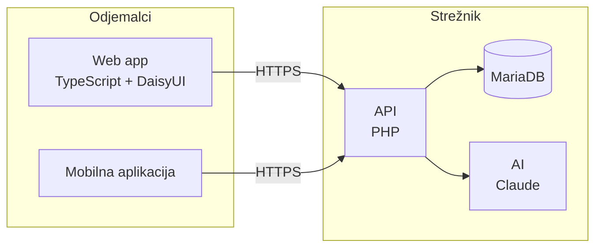

# FreeParkitanje

> Ena največjih frustracij slehernega študenta na FRI je parkiranje !!! Ta projekt temelji na resničnih problemih, katere tudi rešuje.

## Authors

| Name     | GitHub    | Main responsibilities |
| -------- | --------- | --------------------- |
| Avtorica | @ilavtar  | frontend                     |
| Avtor    | @jeraj636 | backend                    |

<!-- Lab repository: one row. Project repository: both team members. -->

## Živi sistem

| Part         | URL                                        |
| ------------ | ------------------------------------------ |
| Web app      | …                                          |
| API (+ docs) | …                                          |
| Health check | …                                          |
| Mobile app   | build instructions below / APK in Releases |

## Architecture

See [docs/architecture.md](docs/architecture.md).

## Stack

| Part          | Technology |
| ------------- | ---------- |
| Backend       | …          |
| Web front end | …          |
| Database      | …          |
| Mobile        | …          |
| Cloud         | …          |
| LLM provider  | …          |

Reasons: see [docs/decisions/](docs/decisions/).

## Running locally

### Prerequisites

- …

### Configuration (secrets)

Describe which environment variables / user secrets are needed and how to set them.
**Never commit real secrets.**

### Start

```bash
# e.g. docker compose up
```

### Tests

```bash
# e.g. dotnet test / npm test / pytest
```

### Mobile app

Mobilna aplikacija bi bila uporabna, ker uporabniki pogosto iščejo parkirno mesto med vožnjo ali tik pred prihodom na cilj. Omogočala bi hitro iskanje prostih parkirnih mest v bližini trenutne lokacije ali izbrane destinacije, pregled njihove razpoložljivosti in cen ter rezervacijo parkirnega mesta neposredno prek telefona. Uporabniki bi lahko dostopali do svojih rezervacij, prejemali obvestila o potrditvah in spremembah ter lažje našli rezervirano parkirno mesto s pomočjo zemljevida in navigacije. Mobilna aplikacija bi tako izboljšala dostopnost sistema, poenostavila postopek rezervacije in uporabnikom prihranila čas pri iskanju parkirišča.
## Documentation

| Document                                       | Content                       |
| ---------------------------------------------- | ----------------------------- |
| [docs/proposal.md](docs/proposal.md)           | Problem, users, user stories  |
| [docs/data-model.md](docs/data-model.md)       | ER diagram                    |
| [docs/architecture.md](docs/architecture.md)   | Components and deployment     |
| [docs/api/openapi.yaml](docs/api/openapi.yaml) | REST API contract             |
| [docs/agent.md](docs/agent.md)                 | Agent tools and guardrails    |
| [docs/decisions/](docs/decisions/)             | Architecture decision records |
| [docs/ai-usage-log.md](docs/ai-usage-log.md)   | How we used AI tools          |
