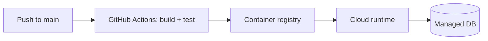

# Architecture

## Components

flowchart LR
    subgraph Clients["Odjemalci"]
        Web["Web app TypeScript + DaisyUI"]
        Mobile["Mobilna aplikacija"]
    end

    subgraph Backend["Strežnik"]
        API["API PHP"]
        DB[("MariaDB")]
        AI["AI Claude"]
    end

    Web -->|HTTPS| API
    Mobile -->|HTTPS| API
    API --> DB
    API --> AI

## Layers (backend)
<!-- Presentation → business logic → data access. Name the main projects/modules. -->

## Authentication & authorization
<!-- How users log in, which token/cookie, which roles, where checks happen. -->

## Deployment
<!-- Cloud services used, how CI/CD deploys, where secrets live, where logs are. -->

