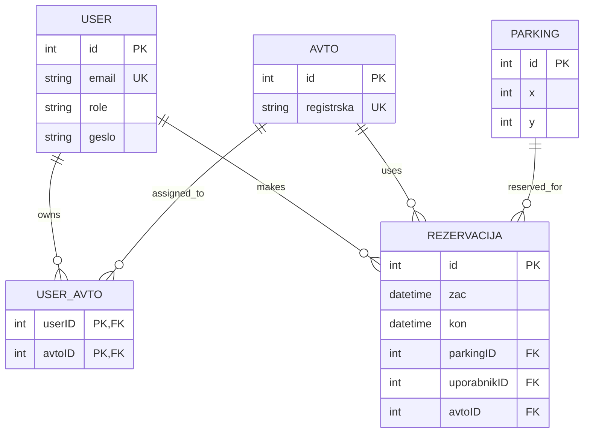

# Data Model

Replace the example with your own model. Requirements: at least 3 entities, one 1:N and one M:N relationship.

## Entities

| Entity | Description | Important rules / constraints |
|--------|-------------|-------------------------------|
| USER| tablea uporabniških računov |  | 
| USER_AVTO| tabla hi pove kateri uporabnik si lasti kateri avto||
|AVTO| tabela avtov, ki jih imajo upoabniki||
|REZARVACIJA|tabela ki hrani podatke o rezervaciji parkinga||
|PARKING| tabela z podtki o vseg parkingih|
## Business rules
Tako kot je v diagramu
